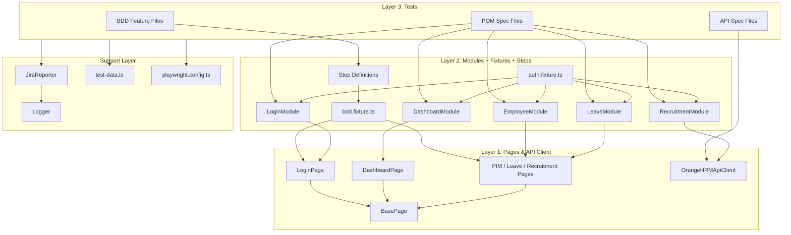
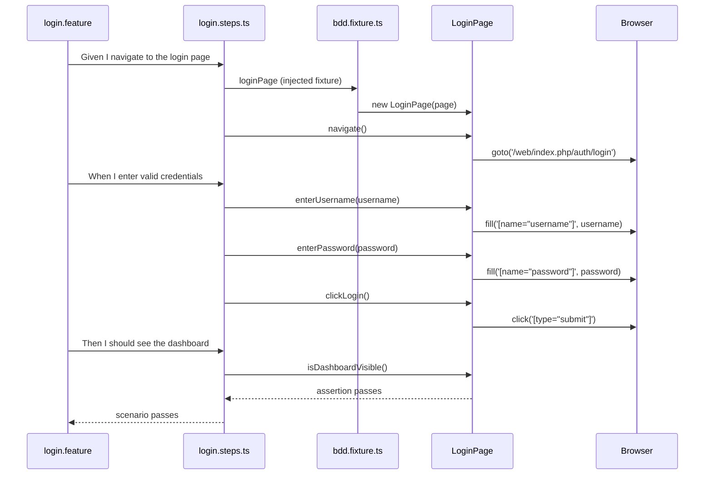
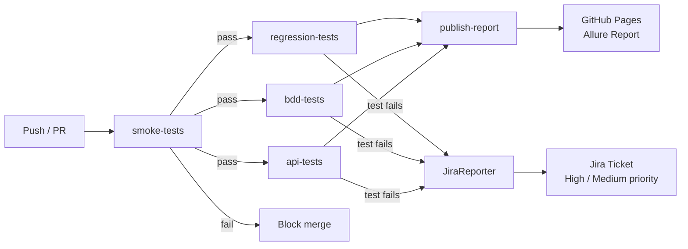
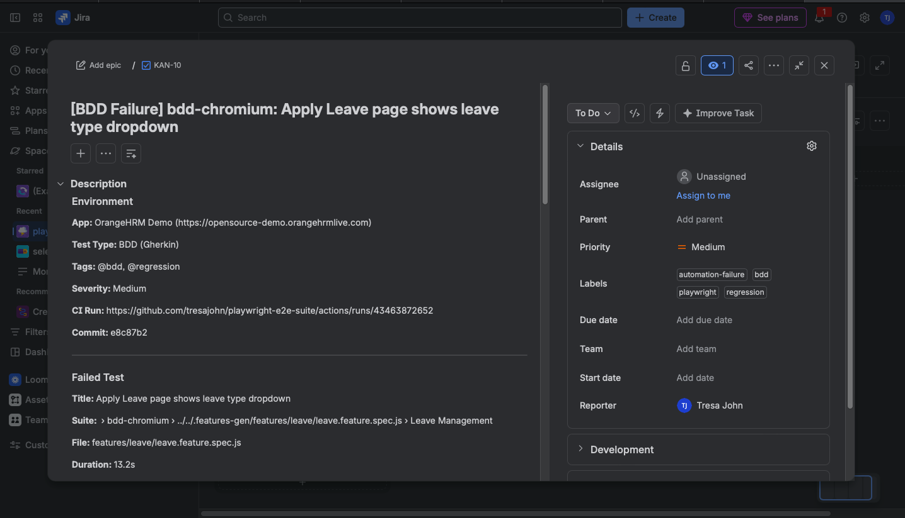
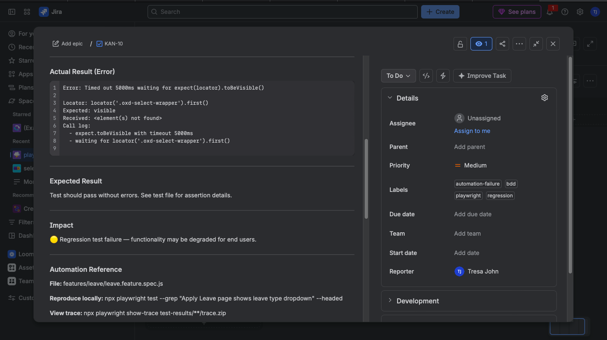
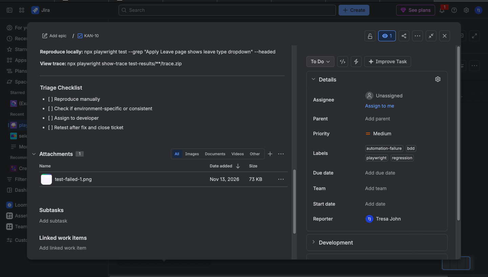

# Playwright E2E Suite

[](https://github.com/tresajohn/playwright-e2e-suite/actions/workflows/playwright.yml)

Playwright test automation framework covering Page Object Model (POM), BDD with Gherkin, REST API testing, Pact consumer-driven contract testing, flaky test detection, an AI-generated scenario validation pipeline, CI/CD via GitHub Actions, and automated Jira ticket creation on test failure.

**Target application:** [OrangeHRM Demo](https://opensource-demo.orangehrmlive.com) — an open-source HR management system

📋 **[View Test Plan](./test-plan.md)** — scope, strategy, equivalence partitions, Gherkin scenarios, and full traceability matrix

---

## Tech Stack

| Tool | Version | Purpose |
|------|---------|---------|
| [Playwright](https://playwright.dev) | 1.49.1 | Browser automation & test runner (Chromium + Firefox) |
| [playwright-bdd](https://vitalets.github.io/playwright-bdd) | 8.x | Gherkin/Cucumber BDD layer |
| TypeScript | 5.x | Type-safe test code |
| [Pact](https://docs.pact.io) | 17.x | Consumer-driven contract testing |
| Allure | 2.x | HTML test reporting with GitHub Pages publish |
| ESLint + Prettier | 9.x / 3.x | Static analysis and formatting, enforced in CI |
| Husky + commitlint | 9.x / 21.x | Git hooks — pre-commit validate gate + Conventional Commits |
| Docker | — | Containerised test runs via official Playwright image |
| Jenkins | — | Parameterised declarative pipeline with shard support |
| GitHub Actions | — | CI/CD pipeline with code-quality gate |
| Jira REST API v3 | — | Auto-create tickets on failure |

---

## 🏗️ Architecture

### Three-Layer Architecture

The framework follows a **3-layer architecture** that covers three distinct test types — BDD, POM E2E, and API — while keeping concerns cleanly separated:

```
┌─────────────────────────────────────────────────────────────┐
│                    LAYER 3: TESTS                           │
│  BDD:  features/**/*.feature  +  steps/**/*.steps.ts        │
│  POM:  tests/e2e/**/*.spec.ts                               │
│  API:  tests/e2e/api/*.api.spec.ts                          │
│  • Gherkin scenarios, test assertions, API validations      │
│  • Grouped by tag: @smoke, @regression, @bdd, @api          │
└─────────────────────────────────────────────────────────────┘
                            │
                            ▼
┌─────────────────────────────────────────────────────────────┐
│          LAYER 2: MODULES + FIXTURES + STEP DEFS            │
│  tests/modules/  LoginModule  EmployeeModule  LeaveModule   │
│                  RecruitmentModule  DashboardModule         │
│  tests/fixtures/auth.fixture.ts   bdd.fixture.ts            │
│  steps/auth/  steps/pim/  steps/leave/  steps/recruitment/  │
│  • Multi-step business workflows (login, addEmployee, etc.) │
│  • Injects modules + pages via Playwright fixture DI        │
│  • Pre-authenticated session shared across all test types   │
└─────────────────────────────────────────────────────────────┘
                            │
                            ▼
┌─────────────────────────────────────────────────────────────┐
│             LAYER 1: PAGE OBJECTS & API CLIENT              │
│  tests/pages/base.page.ts   tests/pages/login.page.ts  ...  │
│  tests/pages/leave/leave-list.page.ts                       │
│  tests/api/orangehrm-api.client.ts                          │
│  • Typed Locator properties — no raw selectors in tests     │
│  • Typed API methods wrapping Playwright APIRequestContext  │
│  • BasePage provides shared helpers (toast, nav, waits)     │
└─────────────────────────────────────────────────────────────┘

                      Support Layer
    ┌──────────────┬──────────────┬────────────┬────────────┐
    │  Reporters   │    Utils     │   Config   │  CI / Env  │
    │ jira.reporter│ test-data.ts │ pw.config  │ GH Actions │
    │flaky.reporter│  logger.ts   │            │ Docker/CI  │
    └──────────────┴──────────────┴────────────┴────────────┘
```

### Layer Responsibilities

| Layer | What goes here | What stays out |
|-------|----------------|----------------|
| **Tests** | Assertions, Gherkin steps, test tags | Business orchestration, locators |
| **Modules** | Multi-step workflows (`login()`, `addEmployee()`, `addVacancy()`) | Assertions, test tags |
| **Fixtures & Steps** | Auth state setup, module + page injection | Test assertions, raw browser calls |
| **Pages & API Client** | Locators, typed API methods, BasePage helpers | Test logic, assertions |

---

## 📊 Flow Diagrams

### Test Execution Flow



### Login Flow (BDD Path)



### CI/CD Pipeline Flow



---

## Project Structure

```
playwright-e2e-suite/
├── features/                    # Gherkin feature files (BDD)
│   ├── auth/login.feature
│   ├── pim/employee.feature
│   ├── leave/leave.feature
│   └── recruitment/recruitment.feature
├── steps/                       # Step definitions
│   ├── auth/login.steps.ts
│   ├── pim/employee.steps.ts
│   ├── leave/leave.steps.ts
│   └── recruitment/recruitment.steps.ts
├── tests/
│   ├── e2e/                     # Spec files
│   │   ├── api/                 # API tests (OrangeHRM REST API v2)
│   │   │   ├── auth.api.spec.ts
│   │   │   ├── employees.api.spec.ts
│   │   │   ├── leave.api.spec.ts
│   │   │   └── vacancies.api.spec.ts
│   │   ├── auth/login.spec.ts
│   │   ├── dashboard/dashboard.spec.ts
│   │   ├── pim/employee.spec.ts
│   │   ├── leave/leave.spec.ts
│   │   └── recruitment/recruitment.spec.ts
│   ├── api/
│   │   └── orangehrm-api.client.ts  # Typed API client
│   ├── contracts/               # Pact consumer-driven contract tests
│   │   ├── employees.pact.spec.ts
│   │   ├── leave-types.pact.spec.ts
│   │   ├── vacancies.pact.spec.ts
│   │   └── pact.config.ts
│   ├── ai-validation/           # AI-generated scenario validation pipeline
│   │   ├── index.ts             # Orchestrator — runs all 4 checks
│   │   ├── validate-scenarios.ts   # Schema validation (AJV)
│   │   ├── traceability.ts         # Requirement coverage check
│   │   ├── duplicate-detector.ts   # Jaccard similarity deduplication
│   │   ├── review-gate.ts          # Human approval gate
│   │   └── schemas/             # JSON schemas for scenario validation
│   ├── fixtures/                # Custom Playwright fixtures
│   │   ├── auth.fixture.ts      # POM fixture (extends @playwright/test)
│   │   └── bdd.fixture.ts       # BDD fixture (extends playwright-bdd)
│   ├── pages/                   # Page Object Model classes
│   │   ├── base.page.ts
│   │   ├── login.page.ts
│   │   ├── dashboard.page.ts
│   │   └── pim/
│   ├── reporters/
│   │   ├── jira.reporter.ts     # Custom reporter — creates Jira tickets on failure
│   │   └── flaky.reporter.ts    # Tracks flaky tests, fails CI if threshold exceeded
│   └── utils/
│       ├── test-data.ts         # Centralised test data constants
│       ├── test-data.factory.ts # Factory functions for unique test data per run
│       ├── logger.ts            # Structured logger — pretty locally, NDJSON in CI
│       ├── index.ts             # Barrel re-export for utils
│       └── logger.test.ts       # Standalone test script for Logger
├── docs/
│   └── test-cases.md            # Manual test case reference
├── .github/workflows/
│   └── playwright.yml           # CI/CD pipeline with code-quality gate
├── .husky/
│   └── pre-commit               # Runs npm run validate before every commit
├── Dockerfile                   # Playwright image — installs deps, runs validate gate
├── docker-compose.yml           # Services: smoke, regression, shard-1 to shard-4
├── Jenkinsfile                  # Declarative pipeline with parameterised shard support
├── .dockerignore                # Excludes node_modules, .env, playwright/.auth
├── commitlint.config.ts         # Conventional Commits enforcement
├── playwright.config.ts
└── .env.example
```

---

## Test Coverage

### POM Tests — 39 tests across 5 spec files

| Module | Tests | Tags |
|--------|-------|------|
| Auth / Login | 9 | `@smoke`, `@regression` |
| Dashboard | 7 | `@smoke`, `@regression` |
| PIM / Employee | 8 | `@smoke`, `@regression` |
| Leave | 7 | `@smoke`, `@regression` |
| Recruitment | 8 | `@smoke`, `@regression` |

### API Tests — 24 tests across 4 spec files

| Endpoint group | Tests | Tags |
|----------------|-------|------|
| Auth session (`/api/v2/pim/employees`) | 4 | `@smoke`, `@regression`, `@api` |
| Employees (`/api/v2/pim/employees`) | 7 | `@smoke`, `@regression`, `@api` |
| Leave types (`/api/v2/leave/leave-types`) | 4 | `@smoke`, `@regression`, `@api` |
| Vacancies (`/api/v2/recruitment/vacancies`) | 6 | `@smoke`, `@regression`, `@api` |

### BDD Tests — 25 scenarios across 4 feature files

| Feature | Scenarios | Tags |
|---------|-----------|------|
| User Authentication | 5 | `@bdd`, `@no-auth`, `@smoke`, `@regression` |
| Employee Management | 7 | `@bdd`, `@smoke`, `@regression` |
| Leave Management | 6 | `@bdd`, `@smoke`, `@regression` |
| Recruitment | 7 | `@bdd`, `@smoke`, `@regression` |

### Contract Tests — 3 Pact spec files (consumer-driven)

| Contract | Interactions | Provider |
|----------|-------------|---------|
| Employees contract | List employees response shape | OrangeHRM API |
| Leave types contract | Leave types list response shape | OrangeHRM API |
| Vacancies contract | Vacancies list response shape | OrangeHRM API |

---

## Setup

```bash
# Install dependencies
npm install

# Install browsers
npx playwright install chromium

# Copy env file and fill in credentials
cp .env.example .env
```

`.env` file:
```
BASE_URL=https://opensource-demo.orangehrmlive.com
ADMIN_USERNAME=Admin
ADMIN_PASSWORD=admin123

# Optional — Jira tickets are only created when these are set
JIRA_BASE_URL=https://yourcompany.atlassian.net
JIRA_EMAIL=your@email.com
JIRA_API_TOKEN=your_jira_api_token
JIRA_PROJECT_KEY=KAN
```

---

## Running Tests

```bash
# Full suite (Chromium + Firefox)
npm test

# Smoke tests only
npm run test:smoke

# Regression tests
npm run test:regression

# BDD tests only
npx playwright test --project=bdd-chromium

# API tests only
npx playwright test --project=api

# Contract tests (Pact)
npm run test:contracts

# Headed mode (watch the browser)
npm run test:headed

# Interactive UI mode
npm run test:ui

# View HTML report
npm run report

# Code quality checks
npm run typecheck          # TypeScript type checking
npm run lint               # ESLint
npm run format:check       # Prettier check
npm run validate           # All three in one — typecheck + lint + format

# AI test validation pipeline
npm run ai:validate        # Run schema, traceability, duplicate, and review-gate checks
```

### Docker

```bash
# Smoke tests (Chromium)
docker compose run --rm smoke

# Regression suite
docker compose run --rm regression

# Full suite — 4 parallel shards
docker compose up shard-1 shard-2 shard-3 shard-4

# Pass custom credentials
BASE_URL=https://your-env.example.com \
ADMIN_USERNAME=admin \
ADMIN_PASSWORD=secret \
docker compose run --rm smoke
```

Artifacts (test-results, playwright-report, allure-results) are written to the matching host directories via mounted volumes.

---

## Git Hooks & Commit Convention

[Husky](https://typicode.github.io/husky/) installs a `pre-commit` hook that runs `npm run validate` (typecheck + lint + format) before every commit. Commits that introduce type errors, lint violations, or formatting drift are rejected locally — matching the CI code-quality gate.

Commit messages are enforced by [commitlint](https://commitlint.js.org/) using the Conventional Commits spec:

```
feat: add structured logger utility
fix: resolve stale locator in leave list page
chore: update Playwright to 1.49.1
```

Allowed types: `feat`, `fix`, `chore`, `docs`, `style`, `refactor`, `test`, `ci`, `perf`, `revert`.

---

## Jenkins Pipeline

`Jenkinsfile` defines a declarative pipeline that runs inside the official `mcr.microsoft.com/playwright:v1.49.1-jammy` Docker image.

**Parameters** (configurable per build):

| Parameter | Default | Description |
|-----------|---------|-------------|
| `TEST_TYPE` | `all` | `all` / `smoke` / `regression` |
| `BROWSER` | `chromium` | `chromium` / `firefox` / `all` (smoke runs only) |
| `SHARD_COUNT` | `4` | Number of parallel shards (used when `TEST_TYPE=all`) |

**Stages:** Checkout → Install (`npm ci`) → Validate (`npm run validate`) → Run Tests

When `TEST_TYPE=all`, the pipeline fans out into N parallel shard stages using Jenkins' `parallel` map — each shard runs `npx playwright test --shard=N/total`.

**Artifacts published per run:**
- Playwright HTML report (linked to build via `publishHTML`)
- `test-results/**/*` and `allure-results/**/*` as downloadable archives

---

## 🔧 Key Design Patterns

### Getter-Based Locators

Page object locators are defined as TypeScript `get` accessors rather than constructor-assigned properties:

```typescript
// tests/pages/login.page.ts
get usernameInput(): Locator { return this.page.locator('[name="username"]'); }
get passwordInput(): Locator { return this.page.locator('[name="password"]'); }
get loginButton():   Locator { return this.page.locator('[type="submit"]'); }
```

Each call re-evaluates the locator against the current DOM snapshot — the same behaviour Playwright recommends for robust element selection. Stale element errors that plague eager assignment don't occur here.

### Page Object Model

All pages extend a shared `BasePage` that provides reusable helpers (`waitForPageLoad`, `getToastMessage`, `clickNavMenuItem`). Locators are defined as typed `Locator` getter properties — no raw selectors scattered across tests.

### BDD with Playwright-BDD v8

Feature files use Gherkin syntax. Step definitions are wired to custom fixtures via `createBdd(test)`, where `test` extends `playwright-bdd`'s base test rather than `@playwright/test`. This allows Playwright fixtures (page objects) to be injected directly into step definitions.

### API Testing with Typed Client

A dedicated `OrangeHRMApiClient` wraps Playwright's `APIRequestContext`, providing typed methods (`getEmployees`, `getEmployee`, `getLeaveTypes`) and centralising request construction. API tests share the same authenticated session as UI tests via fixture inheritance — no duplicate login logic.

### Auth State Reuse

A dedicated `auth.setup.ts` runs once before all tests, logs in, and saves the browser storage state to `playwright/.auth/admin.json`. All subsequent tests load this state instead of logging in on each run — faster and more stable.

### Session Isolation for Auth Tests

Login and logout tests override the shared auth state with an empty cookie jar (`test.use({ storageState: { cookies: [], origins: [] } })`), ensuring they test real authentication flows without polluting the shared session.

### Test Data Factory

A `createEmployeeData()` / `createVacancyData()` factory pattern generates unique entities per run using `randomUUID()` suffixes. Each test receives its own isolated data — no hardcoded names, no cross-test collisions on the shared demo app.

```typescript
import { createEmployeeData } from '../utils/test-data.factory';

const employee = createEmployeeData({ firstName: 'Override' });
// { firstName: 'Override', middleName: 'QA', lastName: 'Test-3f2a1b4c', employeeId: 'EMP-3f2a1b4c' }
```

### Structured Logger

`tests/utils/logger.ts` provides a thin context-tagged logger used by reporters and utilities. Output format adapts to environment:

```typescript
import { Logger } from '../utils/logger';

const logger = new Logger('JiraReporter');
logger.info('Creating Jira ticket for failed test');
logger.error('Jira API call failed', err);
```

- **Local (non-CI):** pretty-printed `[ISO timestamp] [LEVEL] [context] message`
- **CI (`process.env.CI` truthy):** NDJSON — `{"ts":"...","level":"INFO","ctx":"JiraReporter","msg":"..."}` — machine-parseable for log aggregators
- Supports `DEBUG / INFO / WARN / ERROR` levels with a global filter (`Logger.setLogLevel()`)

### Jira Integration

A custom Playwright `Reporter` reads test results and creates Jira issues for every failure on its final retry attempt. Priority is set to **High** for `@smoke` failures and **Medium** for `@regression`. The reporter silently skips if `JIRA_API_TOKEN` is not configured — safe for local runs and forks.

---

## Flaky Test Detection

A custom `FlakyReporter` (`tests/reporters/flaky.reporter.ts`) tracks every test retry across a run. At the end of the suite it emits `test-results/flaky-report.json` and **fails the CI job if the flaky rate exceeds a configurable threshold** (default 10%).

```json
{
  "runDate": "2025-04-01T10:00:00Z",
  "totalTests": 88,
  "flakyCount": 2,
  "flakyRate": 0.023,
  "threshold": 0.10,
  "thresholdExceeded": false,
  "flakyTests": [
    { "title": "should add employee", "file": "pim/employee.spec.ts", "passedOnAttempt": 1 }
  ]
}
```

The threshold is configurable via `FLAKY_THRESHOLD` env var. This prevents flaky tests from silently accumulating — a common blind spot in automation suites.

---

## Contract Testing (Pact)

Three consumer-driven Pact contract specs in `tests/contracts/` verify the shape of OrangeHRM's REST API responses without hitting the real server.

```
Consumer (this framework)  →  Pact mock server  →  Pact file (.json)
                                                          ↓
                                            Provider verifies on their end
```

Each spec uses `PactV3` with `MatchersV3` to define **flexible contracts** — checking structure and types, not exact values:

```typescript
willRespondWith: {
  status: 200,
  body: {
    data: eachLike({
      empNumber: integer(1),
      firstName: pactString('John'),
      lastName:  pactString('Smith'),
    }),
    meta: { total: integer(1) },
  },
}
```

Contracts are generated as `.json` pact files and uploaded as CI artifacts. They serve as a living API specification that breaks immediately if the provider changes a field shape or removes an endpoint.

---

## AI Test Validation Pipeline

`tests/ai-validation/` is a pre-promotion gate for AI-generated test scenarios. Before any AI-authored scenario enters the live suite, it must pass four automated checks (`npm run ai:validate`):

| Step | Check | Failure = |
|------|-------|-----------|
| 1 | **Schema validation** — scenario JSON matches the defined AJV schema | Malformed scenario blocked |
| 2 | **Traceability** — every scenario maps to a known requirement ID | Orphaned scenario blocked |
| 3 | **Duplicate detection** — Jaccard similarity ≥ 0.60 flags redundant scenarios | Duplicate pair flagged for review |
| 4 | **Human review gate** — scenario must be explicitly approved before promotion | Unapproved scenario blocked |

```
═══════════════════════════════════════════════════
  AI Test Validation Pipeline
═══════════════════════════════════════════════════
  Validating 12 AI-generated scenarios

[1/4] Schema Validation
  ✔ All 12 scenarios match the schema

[2/4] Traceability Check
  ✔ All scenarios map to a known requirement
  ✔ All requirements have at least one scenario

[3/4] Duplicate Detection
  ✔ No duplicate scenarios detected

[4/4] Human Review Gate
  ✔ Approved:  12 scenario(s)

✔ All checks passed — scenarios are ready for promotion
═══════════════════════════════════════════════════
```

Exit code `0` = all checks pass, `1` = one or more checks failed — wires cleanly into CI.

---

## CI/CD Pipeline

Six GitHub Actions jobs defined in `.github/workflows/playwright.yml`:

| Job | Trigger | Scope |
|-----|---------|-------|
| `code-quality` | Every push / PR | TypeScript check + ESLint + Prettier + `npm audit` — all other jobs depend on this |
| `contract-tests` | Every push / PR | Pact specs — needs code-quality to pass |
| `smoke-tests` | Every push to main/develop | `@smoke` on Chromium — includes flaky threshold check |
| `regression-tests` | PR to main / push to main | Full suite on Chromium + Firefox — needs smoke to pass |
| `bdd-tests` | PR to main / push to main | BDD project on Chromium — needs smoke to pass |
| `api-tests` | PR to main / push to main | API project — needs smoke to pass |
| `publish-report` | Push to main | Merges Allure results from all jobs → deploys to GitHub Pages |

Each job generates an Allure HTML report uploaded as a downloadable artifact (14-day retention). The publish job merges all results into a combined report at:
**https://tresajohn.github.io/playwright-e2e-suite**

---

## Jira Integration

📋 **[View KAN Board](https://tresajohn.atlassian.net/jira/software/projects/KAN/boards/2)** — live tickets auto-created by the reporter on test failure

  

### How it works

A custom Playwright `Reporter` (`tests/reporters/jira.reporter.ts`) hooks into the test runner's `onTestEnd` event. When any test fails or times out in CI, it calls the Jira REST API v3 to create a Task ticket automatically — no manual step required.

Each ticket includes:
- **Environment block** — app URL, test type (UI / API / BDD), tags, severity, CI run link, commit SHA
- **Failed test details** — title, file path, suite hierarchy, duration
- **Actual result** — verbatim error message in a code block (ANSI codes stripped)
- **Impact statement** — `🔴 Smoke failure` blocks deployment vs `🟡 Regression failure` degrades functionality
- **Automation reference** — exact `npx playwright test --grep "..."` command to reproduce locally
- **Screenshot attachment** — failure screenshot attached directly to the Jira ticket
- **Triage checklist** — reproduce manually → check environment → assign → retest → close

Tickets are labelled `automation-failure`, `playwright`, `ui`/`api`/`bdd`, and `smoke`/`regression`. Priority is set to **High** for `@smoke` failures, **Medium** for `@regression`.

The reporter only fires on a test's **final retry** — no duplicate tickets for flaky tests. It silently skips ticket creation if `JIRA_API_TOKEN` is not configured.

### Required GitHub Secrets

| Secret | Description |
|--------|-------------|
| `JIRA_BASE_URL` | e.g. `https://yourname.atlassian.net` |
| `JIRA_EMAIL` | Atlassian account email |
| `JIRA_API_TOKEN` | Generated at id.atlassian.com → Security → API tokens |
| `JIRA_PROJECT_KEY` | Project key shown in Jira board URL, e.g. `KAN` |

---

## Author

**Tresa John** — QA Automation Engineer  
[LinkedIn](https://www.linkedin.com/in/tresajohn/) · [GitHub](https://github.com/tresajohn)
