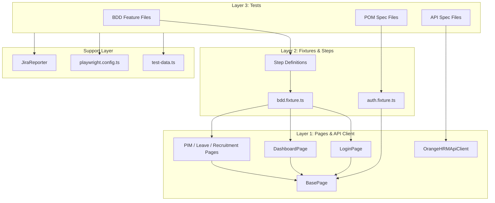
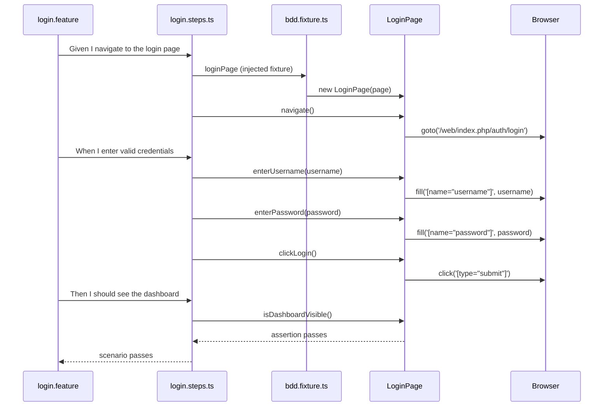
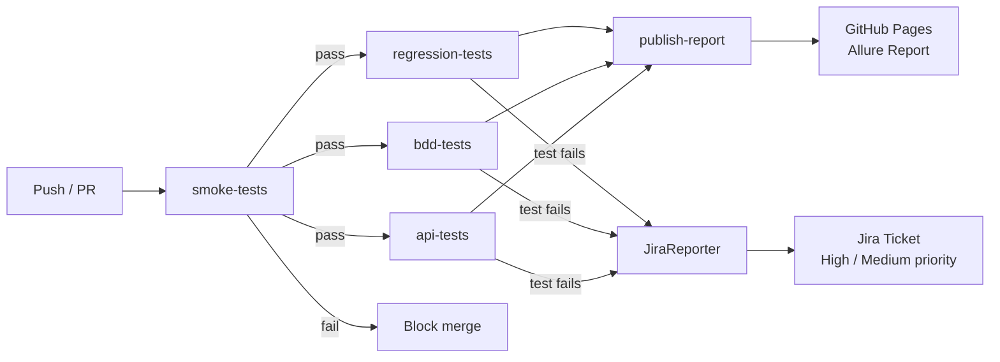

# Playwright E2E Suite

[](https://github.com/tresajohn/playwright-e2e-suite/actions/workflows/playwright.yml)

Playwright test automation framework demonstrating Page Object Model (POM), BDD with Gherkin, API testing, CI/CD via GitHub Actions, and automated Jira ticket creation on test failure.

**Target application:** [OrangeHRM Demo](https://opensource-demo.orangehrmlive.com) — an open-source HR management system

📋 **[View Test Plan](./test-plan.md)** — scope, strategy, equivalence partitions, Gherkin scenarios, and full traceability matrix

---

## Tech Stack

| Tool | Version | Purpose |
|------|---------|---------|
| [Playwright](https://playwright.dev) | 1.49.1 | Browser automation & test runner |
| [playwright-bdd](https://vitalets.github.io/playwright-bdd) | 8.x | Gherkin/Cucumber BDD layer |
| TypeScript | 5.x | Type-safe test code |
| Allure | 2.x | HTML test reporting |
| GitHub Actions | — | CI/CD pipeline |
| Jira REST API v3 | — | Auto-create tickets on failure |

---

## 🏗️ Architecture

### Three-Layer Architecture

The framework follows a **3-layer architecture** that covers three distinct test types — BDD, POM E2E, and API — while keeping concerns cleanly separated:

```
┌─────────────────────────────────────────────────────────────┐
│                    LAYER 3: TESTS                           │
│  BDD:  features/**/*.feature  +  steps/**/*.steps.ts        │
│  POM:  tests/e2e/**/*.spec.ts                               │
│  API:  tests/e2e/api/*.api.spec.ts                          │
│  • Gherkin scenarios, test assertions, API validations      │
│  • Grouped by tag: @smoke, @regression, @bdd, @api          │
└─────────────────────────────────────────────────────────────┘
                            │
                            ▼
┌─────────────────────────────────────────────────────────────┐
│            LAYER 2: FIXTURES & STEP DEFINITIONS             │
│  tests/fixtures/auth.fixture.ts  (POM — storageState auth)  │
│  tests/fixtures/bdd.fixture.ts   (BDD — createBdd() wiring) │
│  steps/auth/  steps/pim/  steps/leave/  steps/recruitment/  │
│  • Injects page objects into BDD step defs via createBdd()  │
│  • Pre-authenticated session shared across all test types   │
└─────────────────────────────────────────────────────────────┘
                            │
                            ▼
┌─────────────────────────────────────────────────────────────┐
│             LAYER 1: PAGE OBJECTS & API CLIENT              │
│  tests/pages/base.page.ts   tests/pages/login.page.ts  ...  │
│  tests/api/orangehrm-api.client.ts                          │
│  • Typed Locator properties — no raw selectors in tests     │
│  • Typed API methods wrapping Playwright APIRequestContext  │
│  • BasePage provides shared helpers (toast, nav, waits)     │
└─────────────────────────────────────────────────────────────┘

                      Support Layer
    ┌──────────────┬──────────────┬────────────┬────────────┐
    │  Reporters   │    Utils     │   Config   │  CI / Env  │
    │ jira.reporter│ test-data.ts │ pw.config  │ GH Actions │
    └──────────────┴──────────────┴────────────┴────────────┘
```

### Layer Responsibilities

| Layer | What goes here | What stays out |
|-------|----------------|----------------|
| **Tests** | Assertions, Gherkin steps, test tags | Business orchestration, locators |
| **Fixtures & Steps** | Auth state setup, page object injection | Test assertions, raw browser calls |
| **Pages & API Client** | Locators, typed API methods, BasePage helpers | Test logic, assertions |

---

## 📊 Flow Diagrams

### Test Execution Flow



### Login Flow (BDD Path)



### CI/CD Pipeline Flow



---

## Project Structure

```
playwright-e2e-suite/
├── features/                    # Gherkin feature files (BDD)
│   ├── auth/login.feature
│   ├── pim/employee.feature
│   ├── leave/leave.feature
│   └── recruitment/recruitment.feature
├── steps/                       # Step definitions
│   ├── auth/login.steps.ts
│   ├── pim/employee.steps.ts
│   ├── leave/leave.steps.ts
│   └── recruitment/recruitment.steps.ts
├── tests/
│   ├── e2e/                     # Spec files
│   │   ├── api/                 # API tests (OrangeHRM REST API v2)
│   │   │   ├── auth.api.spec.ts
│   │   │   ├── employees.api.spec.ts
│   │   │   ├── leave.api.spec.ts
│   │   │   └── vacancies.api.spec.ts
│   │   ├── auth/login.spec.ts
│   │   ├── dashboard/dashboard.spec.ts
│   │   ├── pim/employee.spec.ts
│   │   ├── leave/leave.spec.ts
│   │   └── recruitment/recruitment.spec.ts
│   ├── api/
│   │   └── orangehrm-api.client.ts  # Typed API client
│   ├── fixtures/                # Custom Playwright fixtures
│   │   ├── auth.fixture.ts      # POM fixture (extends @playwright/test)
│   │   └── bdd.fixture.ts       # BDD fixture (extends playwright-bdd)
│   ├── pages/                   # Page Object Model classes
│   │   ├── base.page.ts
│   │   ├── login.page.ts
│   │   ├── dashboard.page.ts
│   │   └── pim/
│   ├── reporters/
│   │   └── jira.reporter.ts     # Custom reporter — creates Jira tickets on failure
│   └── utils/
│       └── test-data.ts         # Centralised test data constants
├── .github/workflows/
│   └── playwright.yml           # CI/CD pipeline
├── playwright.config.ts
└── .env.example
```

---

## Test Coverage

### POM Tests — 39 tests across 5 spec files

| Module | Tests | Tags |
|--------|-------|------|
| Auth / Login | 9 | `@smoke`, `@regression` |
| Dashboard | 7 | `@smoke`, `@regression` |
| PIM / Employee | 8 | `@smoke`, `@regression` |
| Leave | 7 | `@smoke`, `@regression` |
| Recruitment | 8 | `@smoke`, `@regression` |

### API Tests — 24 tests across 4 spec files

| Endpoint group | Tests | Tags |
|----------------|-------|------|
| Auth session (`/api/v2/pim/employees`) | 4 | `@smoke`, `@regression`, `@api` |
| Employees (`/api/v2/pim/employees`) | 7 | `@smoke`, `@regression`, `@api` |
| Leave types (`/api/v2/leave/leave-types`) | 4 | `@smoke`, `@regression`, `@api` |
| Vacancies (`/api/v2/recruitment/vacancies`) | 6 | `@smoke`, `@regression`, `@api` |

### BDD Tests — 25 scenarios across 4 feature files

| Feature | Scenarios | Tags |
|---------|-----------|------|
| User Authentication | 5 | `@bdd`, `@no-auth`, `@smoke`, `@regression` |
| Employee Management | 7 | `@bdd`, `@smoke`, `@regression` |
| Leave Management | 6 | `@bdd`, `@smoke`, `@regression` |
| Recruitment | 7 | `@bdd`, `@smoke`, `@regression` |

---

## Setup

```bash
# Install dependencies
npm install

# Install browsers
npx playwright install chromium

# Copy env file and fill in credentials
cp .env.example .env
```

`.env` file:
```
BASE_URL=https://opensource-demo.orangehrmlive.com
ADMIN_USERNAME=Admin
ADMIN_PASSWORD=admin123

# Optional — Jira tickets are only created when these are set
JIRA_BASE_URL=https://yourcompany.atlassian.net
JIRA_EMAIL=your@email.com
JIRA_API_TOKEN=your_jira_api_token
JIRA_PROJECT_KEY=KAN
```

---

## Running Tests

```bash
# Full suite
npm test

# Smoke tests only
npm run test:smoke

# Regression tests
npm run test:regression

# BDD tests only
npx playwright test --project=bdd-chromium

# API tests only
npx playwright test --project=api

# Headed mode (watch the browser)
npm run test:headed

# Interactive UI mode
npm run test:ui

# View HTML report
npm run report
```

---

## 🔧 Key Design Patterns

### Page Object Model

All pages extend a shared `BasePage` that provides reusable helpers (`waitForPageLoad`, `getToastMessage`, `clickNavMenuItem`). Locators are defined as typed `Locator` properties — no raw selectors scattered across tests.

### BDD with Playwright-BDD v8

Feature files use Gherkin syntax. Step definitions are wired to custom fixtures via `createBdd(test)`, where `test` extends `playwright-bdd`'s base test rather than `@playwright/test`. This allows Playwright fixtures (page objects) to be injected directly into step definitions.

### API Testing with Typed Client

A dedicated `OrangeHRMApiClient` wraps Playwright's `APIRequestContext`, providing typed methods (`getEmployees`, `getEmployee`, `getLeaveTypes`) and centralising request construction. API tests share the same authenticated session as UI tests via fixture inheritance — no duplicate login logic.

### Auth State Reuse

A dedicated `auth.setup.ts` runs once before all tests, logs in, and saves the browser storage state to `playwright/.auth/admin.json`. All subsequent tests load this state instead of logging in on each run — faster and more stable.

### Session Isolation for Auth Tests

Login and logout tests override the shared auth state with an empty cookie jar (`test.use({ storageState: { cookies: [], origins: [] } })`), ensuring they test real authentication flows without polluting the shared session.

### Jira Integration

A custom Playwright `Reporter` reads test results and creates Jira issues for every failure on its final retry attempt. Priority is set to **High** for `@smoke` failures and **Medium** for `@regression`. The reporter silently skips if `JIRA_API_TOKEN` is not configured — safe for local runs and forks.

---

## CI/CD Pipeline

Five GitHub Actions jobs defined in `.github/workflows/playwright.yml`:

| Job | Trigger | Scope |
|-----|---------|-------|
| `smoke-tests` | Every push to main/develop | `@smoke` on Chromium |
| `regression-tests` | PR to main / push to main | Full suite on Chromium — needs smoke to pass |
| `bdd-tests` | PR to main / push to main | BDD project on Chromium — needs smoke to pass |
| `api-tests` | PR to main / push to main | API project — needs smoke to pass |
| `publish-report` | Push to main | Merges Allure results from all jobs → deploys to GitHub Pages |

Each job generates an Allure HTML report uploaded as a downloadable artifact (14-day retention). The publish job merges all results into a combined report at:
**https://tresajohn.github.io/playwright-e2e-suite**

---

## Jira Integration

### How it works

A custom Playwright `Reporter` (`tests/reporters/jira.reporter.ts`) hooks into the test runner's `onTestEnd` event. When any test fails or times out in CI, it calls the Jira REST API v3 to create a Task ticket automatically — no manual step required.

Each ticket includes:
- **Environment block** — app URL, test type (UI / API / BDD), tags, severity, CI run link, commit SHA
- **Failed test details** — title, file path, suite hierarchy, duration
- **Actual result** — verbatim error message in a code block (ANSI codes stripped)
- **Impact statement** — `🔴 Smoke failure` blocks deployment vs `🟡 Regression failure` degrades functionality
- **Automation reference** — exact `npx playwright test --grep "..."` command to reproduce locally
- **Screenshot attachment** — failure screenshot attached directly to the Jira ticket
- **Triage checklist** — reproduce manually → check environment → assign → retest → close

Tickets are labelled `automation-failure`, `playwright`, `ui`/`api`/`bdd`, and `smoke`/`regression`. Priority is set to **High** for `@smoke` failures, **Medium** for `@regression`.

The reporter only fires on a test's **final retry** — no duplicate tickets for flaky tests. It silently skips ticket creation if `JIRA_API_TOKEN` is not configured.

### Required GitHub Secrets

| Secret | Description |
|--------|-------------|
| `JIRA_BASE_URL` | e.g. `https://yourname.atlassian.net` |
| `JIRA_EMAIL` | Atlassian account email |
| `JIRA_API_TOKEN` | Generated at id.atlassian.com → Security → API tokens |
| `JIRA_PROJECT_KEY` | Project key shown in Jira board URL, e.g. `KAN` |

---

## Author

**Tresa John** — QA Automation Engineer  
[LinkedIn](https://www.linkedin.com/in/tresajohn/) · [GitHub](https://github.com/tresajohn)
